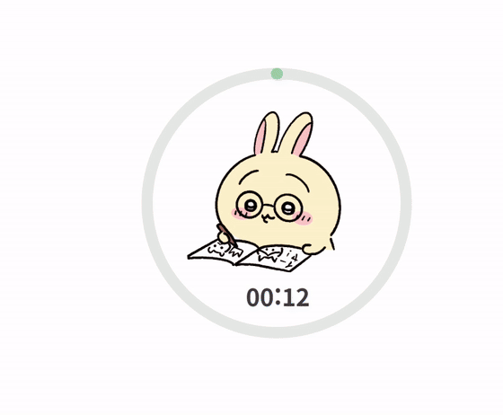
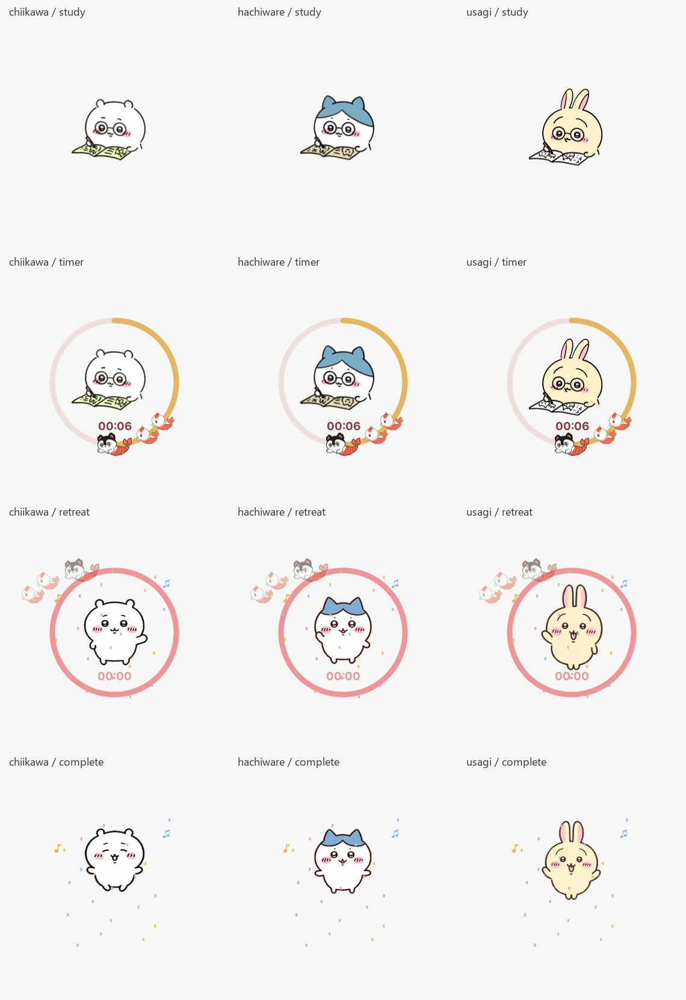

<div align="center">

# 치이카와 타이머 3종 🐾

### 책상 위 작은 친구들과, 오늘도 한 페이지 📖

치이카와 · 하치와레 · 우사기와 함께 공부하고<br>
집중을 마치면 노래와 공연으로 축하해요.


**[📦 타이머 다운로드](https://raw.githubusercontent.com/skgr07/chiikawa_timer_share/main/chiikawa_timer_source_shortcut.zip)**

<sub>Python 소스 + 사용자 PC에서 만드는 바로가기 방식으로 실행합니다.</sub>

</div>

---

## 🤍 치이카와

안경을 쓰고 꼬박꼬박 공부하다가, 집중을 마치면 신나는 파티가 시작돼요.

<table>
  <tr><th>공부 모션</th><th>타이머 종료 모션</th></tr>
  <tr>
    <td align="center"></td>
    <td align="center"></td>
  </tr>
</table>

🎵 **완료 노래: 파자마 파티즈** · 27초<br>
[음악 원본 보기 ↗](https://www.youtube.com/watch?v=rZcich2neds&t=5s)

## 🩵 하치와레

나란히 공부해 주는 든든한 친구. 끝까지 집중했다면 하치와레의 노래를 들어 보세요.

<table>
  <tr><th>공부 모션</th><th>타이머 종료 모션</th></tr>
  <tr>
    <td align="center"></td>
    <td align="center"></td>
  </tr>
</table>

🎵 **완료 노래: 혼잣말** · 57초<br>
[음악 원본 보기 ↗](https://www.youtube.com/watch?v=GKC1P0mCt4o)

## 💛 우사기

공부할 때는 진지하게, 끝날 때는 우사기답게! 마지막은 신나는 우사기 랩으로 마무리해요.

<table>
  <tr><th>공부 모션</th><th>타이머 종료 모션</th></tr>
  <tr>
    <td align="center"></td>
    <td align="center"></td>
  </tr>
</table>

🎵 **완료 노래: 우사기 랩** · 16초<br>
[음악 원본 보기 ↗](https://www.youtube.com/watch?v=fecqNKavDWE&t=21s)

<sub>GIF에는 소리가 없습니다. 실제 프로그램에서는 완료 노래를 켜면 캐릭터별 음악이 재생됩니다.</sub>

---

## 🧜 세이렌이 한 바퀴 도는 동안, 집중!

<div align="center">
  
</div>

타이머를 설정하면 공부하는 캐릭터 주변에 원과 남은 시간이 나타나요. 세이렌과 인어 두 마리가 원을 따라 한 바퀴 도는 동안, 해야 할 일에 집중해 보세요.

시간이 흐르면 타이머 색이 빨간색으로 바뀌고, 시간이 다 되면 세이렌과 인어들이 물러나요. 원과 시간 표시도 함께 사라지고 캐릭터의 축하 공연이 시작됩니다.

| 기능 | 사용 방법 |
| :--- | :--- |
| 집중 시간 | 15분 · 30분 · 60분 또는 커스텀 1~180분 |
| 잠깐 쉬기 | 우클릭 → 타이머 설정 → 일시정지 / 계속하기 |
| 타이머 해제 | 우클릭 → 타이머 설정 → 타이머 해제 |
| 세이렌·음악 | 타이머 설정에서 각각 켜거나 끄기 |
| 캐릭터 선택 | 우클릭 → 캐릭터 설정 → 치이카와 / 하치와레 / 우사기 |
| 원하는 위치로 | 캐릭터를 드래그하면 원과 시간도 함께 이동 |
| 프로그램 종료 | 대기 중 타이머 설정 → 종료, 또는 알림 영역 아이콘 → 종료 |

<sub>GIF는 기존 브라우저 데모에서 촬영한 소개용 영상입니다. 현재 Python 앱의 실제 배치와 화면은 아래 이미지에서 확인할 수 있어요.</sub>

<details>
<summary>현재 Python 앱 화면 보기</summary>



<sub>미리보기의 밝은 배경은 비교용입니다. 실제 앱의 캐릭터 주변은 투명합니다.</sub>

</details>

## 📦 다운로드 & 처음 실행하기

1. **[타이머 ZIP 다운로드](https://raw.githubusercontent.com/skgr07/chiikawa_timer_share/main/chiikawa_timer_source_shortcut.zip)**를 눌러 받으세요.
2. ZIP **전체를 압축 해제**하고, 안쪽의 `chiikawa_timer_python` 폴더를 여세요.
3. Windows 64비트용 **[Python 3.10 이상](https://www.python.org/downloads/windows/)**을 설치하세요. 설치 시 Python 실행 명령을 사용할 수 있도록 설정합니다.
4. 프로그램 폴더에서 터미널을 열고 아래 두 명령을 차례대로 실행하세요.

```powershell
py -m pip install -r requirements.txt
py create_shortcut.py
```

5. 생성된 **`치이카와 타이머.lnk`**를 더블클릭하세요. 검은 콘솔 창 없이 캐릭터가 나타납니다.

바로가기는 바탕화면에 복사해도 됩니다. 최초 설정에 쓴 터미널을 닫아도 타이머는 계속 실행됩니다. 프로그램 폴더를 옮기거나 Python 설치 경로가 바뀌면 `py create_shortcut.py`를 다시 실행하세요.

<details>
<summary>여러 Python 버전이 설치되어 있다면</summary>

설치와 바로가기 생성에 같은 Python을 사용하세요. 예를 들어 Python 3.12를 사용할 때는:

```powershell
py -3.12 -m pip install -r requirements.txt
py -3.12 create_shortcut.py
```

문제를 확인할 때는 터미널에서 `py chiikawa_timer.py`로 실행하면 오류 내용을 볼 수 있습니다.

</details>

<details>
<summary>12초 체험으로 확인하기</summary>

```powershell
py chiikawa_timer.py --demo --character chiikawa
py chiikawa_timer.py --demo --character hachiware
py chiikawa_timer.py --demo --character usagi
```

원하는 캐릭터의 명령 하나를 실행하세요.

</details>

<details>
<summary>실행 방식 안내</summary>

이 배포본은 Python 소스입니다. 바로가기는 사용자 PC의 `pythonw.exe`로 소스를 실행하며, 제작자의 경로가 들어 있는 바로가기를 그대로 배포하지 않습니다. 앱을 실행하는 Python 프로세스를 종료하면 타이머도 종료됩니다.

Python과 Qt 라이브러리에도 Windows의 실행 정책이 적용됩니다. 바로가기 사용은 코드 서명이나 스마트 앱 컨트롤의 허용을 의미하지 않습니다.

</details>

[배포 ZIP의 SHA256 확인](SHA256SUMS.txt)

---

<details>
<summary>자료 출처 · 제작 안내</summary>

- 개인 팬 제작·수정본으로, 공식 치이카와 제품이 아닙니다.
- 원본 데스크톱 펫: [CookieElmo](https://cookieelmo.itch.io/desktop-chiikawa)
- 우사기 도트: [chiikawa-dots-pets](https://github.com/heelee912/chiikawa-dots-pets)
- 치이카와 캐릭터: nagano
- 세이렌·인어: AI 팬 일러스트
- 구현: Python + PySide6 · 글꼴: Pretendard
- GIF: 기존 브라우저 시연 영상 · 비교 PNG: 최종 Python 앱 렌더링
- 음악 출처와 라이브러리 라이선스 안내는 배포본의 `자료 출처.txt`, `README.md`, `Pretendard-LICENSE.txt`를 확인하세요.
- 원본 콘텐츠의 권리는 각 권리자에게 있습니다. 이 저장소는 제삼자 이미지·음악에 별도의 이용 허락을 부여하지 않습니다.

</details>

<div align="center">
  <sub>작은 친구들과 함께, 오늘의 집중도 차곡차곡 🌱</sub>
</div>
